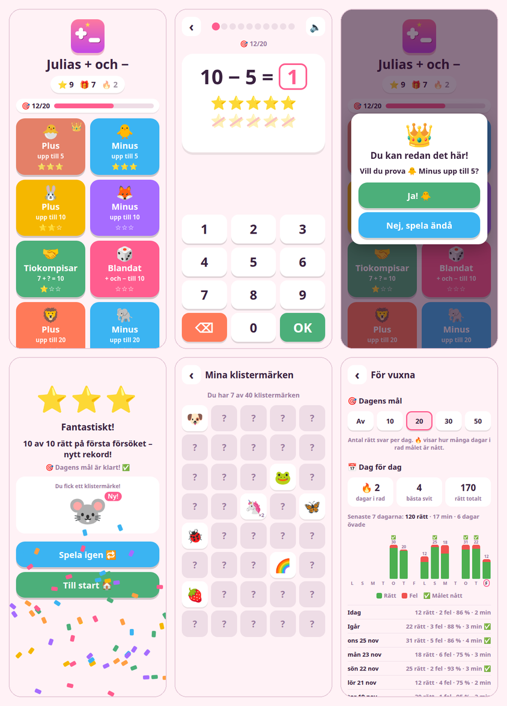

# Julias + och −

En liten app (PWA) där barn övar plus och minus upp till 20. Den är gjord för en 6-åring.

**Prova appen:** https://perkarom.github.io/plusminus/

- 8 nivåer: plus/minus upp till 5, 10 och 20, tiokompisar och blandat.
- Bilder att räkna på, i grupper om fem. De visas direkt på de lätta nivåerna och via 💡 annars.
- Två försök per tal. Efter två fel visas svaret med bilder, och samma tal kommer tillbaka senare i omgången.
- Stjärnor per nivå och ett klistermärke efter varje omgång. Albumet (40 st) har en egen stor knapp på startsidan, och man kommer dit också genom att trycka på det nya klistermärket efter en omgång.
- **👑 Krona:** efter 3 omgångar med tre stjärnor på en nivå får den en krona. Appen föreslår då en svårare nivå (både i text och uppläst), och det gör den också när man trycker Spela igen efter tre stjärnor. Nivåer med krona räknas inte till dagens mål eller dagar i rad.
- **🎯 Dagens mål:** ett antal rätt svar per dag (10, 20, 30 eller 50, förvalt 20). När målet nås kommer konfetti och "Hurra! Dagens mål är klart!".
- **🔥 Dagar i rad:** dagar då målet nåtts, visas på startsidan. Utan mål räcker ett rätt svar om dagen.
- **👨‍👩‍👧 För vuxna:** välja dagens mål, se dag för dag (staplar för 14 dagar och en lista), nivåerna med stjärnor och kronor, Så funkar det, spara och hämta allt som fil, och börja om.
- Appen uppdaterar sig själv, även när den redan är öppen: den letar efter en ny version när den kommer fram på skärmen igen och var 15:e minut. Den byter aldrig mitt i en omgång eller när en ruta är öppen. Raden längst ner på startsidan visar om den är uppdaterad.
- **🎉 Nytt i appen:** efter en uppdatering visas nyheterna en gång i en ruta med stora ikoner, och de läses upp. Nyheterna står i `NEWS` i `app.js`, och varje post behöver ett ljudklipp `audio/nyhet_<version>.mp3`.
- Uppe till höger i spelet: 🗣️/🤫 slår uppläsningen av och på och 🔊/🔇 pipljuden, utan att gå till startsidan. Tryck på talet för att höra det igen.
- Uppläsningen sker på svenska med inspelade klipp (`audio/`, rösten sv-SE-SofieNeural via edge-tts). Klippen hämtas när talet visas. Saknas ett klipp används telefonens röst.

Vanlig HTML/CSS/JS utan byggsteg. Vid varje ny version: höj `CACHE` i `sw.js` och `APP_VERSION` i `app.js` till samma nummer.
